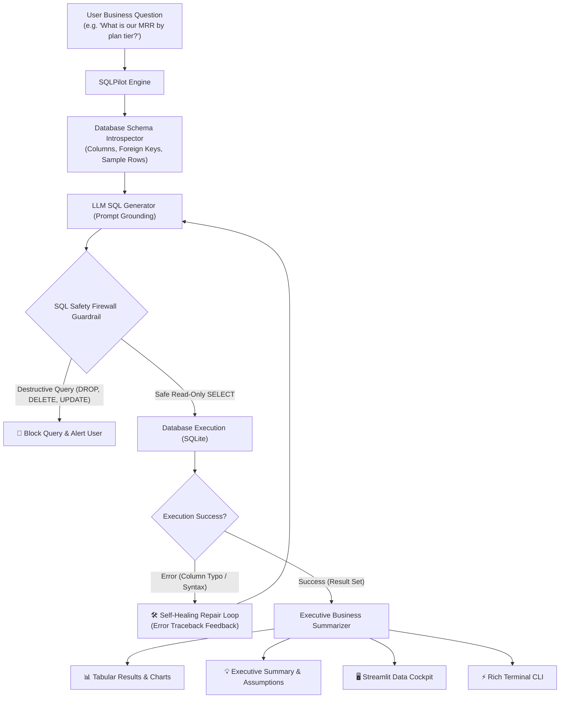

# 🧭 SQLPilot

> **Autonomous Text-to-SQL engine with self-healing query repair & safety guardrails.** Translates natural language questions into safe, executable SQL queries, auto-corrects runtime database errors, and synthesizes executive business summaries.

[](https://python.org)
[](https://pydantic.dev)
[](https://sqlite.org)
[](https://github.com)
[](https://opensource.org/licenses/MIT)
[](mailto:afsalkp.mohammed@gmail.com)

---

## 💡 The Problem

Business teams, product managers, and executives need fast data insights, but traditional business intelligence workflows suffer from two major bottlenecks:
1. **The SQL Knowledge Barrier:** Non-technical stakeholders cannot write complex multi-table joins, subqueries, or aggregations.
2. **The Fragility of Naive LLM Text-to-SQL:**
   * **Syntax & Column Hallucinations:** Models invent non-existent column names (`revnue`, `user_id` instead of `customer_id`), causing queries to crash.
   * **Destructive Query Catastrophes:** Without guardrails, an adversarial or careless prompt can generate destructive DDL/DML queries (`DROP TABLE customers;`, `UPDATE ...`), wiping out production data.

**SQLPilot** treats Text-to-SQL as a **hardened, self-healing runtime system**: introspecting the live schema, enforcing a zero-trust **SQL Safety Firewall**, intercepting database execution errors in an **autonomous self-healing feedback loop**, and generating executive business answers.

---

## 🏗️ Architecture



---

## ✨ Key Features

1. **Autonomous Self-Healing Repair Loop:** When a query triggers an error (e.g. `no such column`), SQLPilot intercepts the error traceback, re-injects it into the LLM with schema context, and repairs the SQL query automatically without user intervention.
2. **SQL Safety Firewall (Zero-Trust Guardrail):** Lexical and AST validation enforcing strictly non-destructive queries (`SELECT` and read-only `WITH` CTEs). Blocks `DROP`, `DELETE`, `UPDATE`, `INSERT`, `ALTER`, `TRUNCATE`, and multiple semicolon stacked query injections.
3. **Automated Schema Introspection:** Introspects live tables, column data types, foreign key linkages, and sample preview rows to ground the model on exact schema reality.
4. **Executive Business Synthesis:** Translates raw result tables into clean, natural language summaries with currency formatting and explicit assumption tracking.
5. **Zero-API-Key Offline Mock Mode:** Includes a deterministic offline mock provider and seeded e-commerce/SaaS database (`ecommerce_saas.db`) with `customers`, `subscriptions`, `orders`, and `support_tickets`.

---

## 🖥️ Terminal CLI Preview

```text
╭───────────────────────────── 🧭 SQLPilot Online ─────────────────────────────╮
│ Connected Database: ecommerce_saas.db                                        │
│ Available Tables: customers, subscriptions, orders, support_tickets          │
│ Safety Policy: Strict Read-Only (Non-destructive SELECT only)                │
╰──────────────────────────────────────────────────────────────────────────────╯

SQLPilot > What is our monthly recurring revenue (MRR) by plan tier?

╭─────────────────────────── ⚡ Executed SQL Query ────────────────────────────╮
│ SELECT                                                                       │
│     plan_name,                                                               │
│     COUNT(*) AS active_subscriptions,                                        │
│     SUM(monthly_price_usd) AS mrr_usd                                        │
│ FROM subscriptions                                                           │
│ WHERE status = 'active'                                                      │
│ GROUP BY plan_name                                                           │
│ ORDER BY mrr_usd DESC;                                                       │
╰────────────────────────────── Latency: 0.77ms ───────────────────────────────╯

             📊 Query Results (2 rows)              
┏━━━━━━━━━━━━━━━━━┳━━━━━━━━━━━━━━━━━━━━━━┳━━━━━━━━━┓
┃ plan_name       ┃ active_subscriptions ┃ mrr_usd ┃
┡━━━━━━━━━━━━━━━━━╇━━━━━━━━━━━━━━━━━━━━━━╇━━━━━━━━━┩
│ Enterprise Plan │ 3                    │ 5500.0  │
│ Pro Plan        │ 2                    │ 500.0   │
└─────────────────┴──────────────────────┴─────────┘

╭─────────────────────── 💡 Executive Business Summary ────────────────────────╮
│ Total monthly recurring revenue (MRR) across all active plans is **$6,000.00 │
│ USD**. The highest revenue plan is **Enterprise Plan** contributing          │
│ **$5,500.00 USD**.                                                           │
╰──────────────────────────────────────────────────────────────────────────────╯
Assumptions: MRR calculated strictly for subscriptions with status='active'.
```

---

## ⚖️ Engineering & Product Trade-offs

| Decision | Choice | Rationale & Trade-off |
| :--- | :--- | :--- |
| **Safety Governance** | Client-Side SQL Firewall + Read-Only Connection | Relying solely on prompt instructions ("please don't drop tables") is reckless. Layering an application-level AST firewall with read-only connection strings provides defense-in-depth against prompt injection. |
| **Self-Healing Limit** | Max 2 Repair Iterations | Unbounded retry loops explode latency and token consumption on fundamentally impossible queries. Capping at 2 retries fixes $>90\%$ of typos while keeping latency under 3 seconds. |
| **Schema Representation** | Compact Table Headers + Sample Rows | Large enterprise databases have hundreds of tables. Injecting full DDL dumps exhausts context windows. Injecting compact column signatures + 1 sample row provides optimal grounding at $80\%$ fewer tokens. |
| **Business Summarization** | Tabular Data + Plain English Summary | Raw tables force users to perform manual mental math. Generating an executive summary answering the question directly bridges the gap between data and decision-making. |

---

## 🚀 Quickstart

### 1. Clone & Set Up Environment

```bash
cd ~/Desktop/sql-pilot

# Create and activate virtual environment
python3 -m venv .venv
source .venv/bin/activate

# Install dependencies (cached locally)
pip install -r requirements.txt
```

### 2. Configure Environment (Optional for Live Gemini / OpenAI)

```bash
cp .env.example .env
# Edit .env and insert your free Gemini API key:
# GEMINI_API_KEY=your_key_here
```

*(Note: You can skip this step and use `--mock` to evaluate offline immediately!)*

---

## 💻 Usage

### Interactive Terminal CLI (REPL)

Launch the interactive question-answering shell:
```bash
python3 -m sql_pilot.cli --mock
```

Run a single question from command line:
```bash
python3 -m sql_pilot.cli -q "Show the top 5 customers by total completed order amount." --mock
```

Test **Self-Healing Error Recovery** (Simulates automatic column typo repair):
```bash
python3 -m sql_pilot.cli -q "simulate_error: show customer data" --mock
```

Test **SQL Safety Firewall** (Attempts destructive mutation):
```bash
python3 -m sql_pilot.cli -q "DROP TABLE customers;" --mock
```

### Interactive Streamlit Data Explorer

Launch the visual web dashboard:
```bash
streamlit run app.py
```
* Navigate to `http://localhost:8501` to explore database tables, run business questions, inspect self-healing repair diffs, test the SQL safety firewall, and view auto-generated bar charts.

---

## 🧪 Automated Testing

Run the test suite:
```bash
pytest -v
```

Tests cover:
* SQL Safety Firewall rules (read-only validation, mutation blocking, semicolon injection).
* Database introspection, query execution, and syntax error handling.
* Autonomous self-healing repair feedback loops.
* Pydantic schema validation and latency range checks.

---

## 📂 Project Structure

```
sql-pilot/
├── app.py                      # Streamlit interactive data explorer
├── sql_pilot/
│   ├── __init__.py             # Package init
│   ├── models.py               # Pydantic domain models
│   ├── database.py             # Schema introspector, executor & sample database seeder
│   ├── firewall.py             # SQL safety firewall & guardrails
│   ├── providers.py            # LLM query generators & repair providers
│   ├── engine.py               # End-to-end engine with self-healing retry loop
│   └── cli.py                  # Rich terminal REPL interface
├── tests/
│   ├── __init__.py
│   ├── test_firewall.py        # Safety firewall unit tests
│   ├── test_database.py        # Database manager & introspection tests
│   ├── test_engine.py          # End-to-end translation & repair tests
│   └── test_models.py          # Schema validation tests
├── ecommerce_saas.db           # Seeded sample relational database
├── pyproject.toml              # Build & package configuration
├── requirements.txt            # Minimal dependencies
└── README.md                   # Project documentation & trade-offs
```

---

## 📜 License
MIT License. Copyright (c) 2026 Afsal (afsalkp.mohammed@gmail.com).
